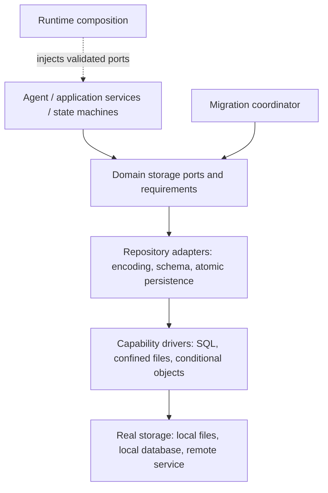

# State contracts and replaceable storage

Status: approved and native stages 1 to 3 implemented on 2026-10-06.
Verification: `make check-fast` passed after rebasing onto `8039e03`;
validated implementation head `afe4063` (2551 native and 605 core unit tests,
integration suites, formatting, Clippy and WASM compatibility).
No alternative live cloud service has been selected or approved yet.
Base: `10c60cc`.

## Requirements

User requirements, 2026-10-06:

- Define explicit layers, interfaces, ownership and behavior.
- Separate state semantics from storage implementations and deployed services.
- A state domain declares its durability, concurrency and transaction requirements.
- Replace storage services through drivers/adapters that satisfy these contracts,
  including verified data migration.
- Be open for extension and closed for modification: adding a backend must not
  change existing business services, state machines or frontend behavior.
- Organize code/directories around these owners, with enforceable dependency rules.
- Use inversion of control at composition boundaries: services declare ports;
  runtime injects implementations. No additional IoC framework is needed.

This proposal covers Otto-owned persistent state. Working files edited by tools,
provider credentials and executable trust remain under their existing local
security boundaries. Cloud persistence does not turn an object store into a
local execution workspace. Transient turn queues, steering, cancellation tokens
and live process handles remain in memory; persisting them would require an
explicit domain recovery contract.

## Starting boundaries

| Area | Existing boundary | Coupling to remove |
| --- | --- | --- |
| SQL | `crates/otto/src/storage.rs` | Concrete Turso connection, errors, rows, values, params and SQLite-specific operations are exposed to callers |
| Memory | `memory/service.rs`, `memory/turso/` | Service owns the concrete Turso store; search/index behavior lives in that implementation |
| Approvals | `approval/mod.rs` | Authority/service and SQL persistence share a module; decisions and events commit together |
| Workflows/schedules | `workflow.rs`, `schedule/store.rs` | SQL schema, transactional mutations and runtime orchestration are coupled |
| Sessions | `otto-core/src/session/`, native `session/` | Neutral transcript contract exists, but discovery, paths, leases and native writes remain concrete |
| File state | `fsops.rs`, `workspace.rs`, `failover/lease.rs` | Pinned filesystem operations, local identities and writer ownership are concrete |
| Migration | `cli/storage.rs` | Existing offline importer handles recognized legacy SQL databases; it is not a general backend migration contract |

The core `Session` already has async message/compaction writes, but custom
entries and operation-fact writes are synchronous. Replacing the storage
connection alone would leave these service and lifecycle couplings intact.

## Layer boundaries



| Layer | Owns | Must not own |
| --- | --- | --- |
| Domain service/state machine | Valid transitions, authorization, recovery policy and state invariants | SQL, filenames, SDK types, backend selection |
| Domain storage port | Typed reads/mutations, expected revisions, atomic scope, commit/error behavior and migration records | Provider dialect, paths or storage SDK |
| Repository adapter | Encoding, physical schema/query/index plans, atomic enforcement of preconditions and persistence invariants | Human authority, agent scheduling, presentation |
| Capability driver | Transactions/I/O, conditional writes, durability acknowledgements, transport and error classification | Business transitions or approval policy |
| Storage service | Actual engine/filesystem/remote deployment and its configured guarantees | Otto-specific state semantics |

Dependencies point down. Runtime composition depends on concrete adapters to
construct them, but passes only ports to consumers. Drivers never import
application/frontends. Neutral types used by core and browser consumers remain
in `otto-core`; native repositories, SDKs and credentials remain in `otto`.
Use modules first; this proposal does not require another crate hierarchy.

## Code organization

Keep domain ownership visible in the existing domain directories. Backend
implementations sit together under their backend name; adding a backend adds
one subtree, rather than provider branches across every domain. The proposed
tree shows the layout for real responsibilities, not mandatory empty files:

```text
crates/otto-core/src/
  approval.rs                 shared approval states and wire contracts
  session/                    Pi codec, context and neutral session contract
  agent/                      orchestration; no native backend dependencies

crates/otto/src/
  memory/
    contracts.rs              existing records, requests and domain errors
    repository.rs             MemoryStore + logical migration contract
    service.rs                policy, validation and use cases
    ...                       existing guards, advice and domain helpers
  approval/
    mod.rs                    public domain facade/reexports
    repository.rs             ApprovalStore + logical migration contract
    service.rs                authority and application coordination
    config.rs, memory.rs, ... existing domain application adapters
  session/
    mod.rs                    public session facade
    repository.rs             SessionStore, stable refs and migration records
    ...                       projections, validation and recovery use cases
  workflow/
    mod.rs                    public workflow facade
    contracts.rs              run/step/attempt types and transitions
    repository.rs             WorkflowStore + migration contract
    service.rs                scheduler/recovery coordination
    ...                       existing catalog/executor responsibilities
  schedule/, reflection/, subagent/, usage/, workspace/
                              same ownership rule; split only coupled code
  skill/                      domain policy and skill-check audit port

  storage/
    mod.rs                    common persistence-contract facade
    contracts.rs              capability profiles, versions and error categories
    sql.rs                    SQL value/row/transaction driver contracts
    files.rs                  confined handle and publication contracts
    objects.rs                versioned object/conditional-write contracts
    drivers/
      turso.rs                native engine/connection/transaction operations
      posix.rs                pinned descriptor primitives; current fsops reused
    backends/
      turso/
        mod.rs                factory and schema-version entry points
        memory/, approval.rs, workflow.rs, schedule.rs, ...
                              domain repositories, SQL, indexes and codecs
      posix/
        mod.rs                factory
        session/, workspace.rs, artifacts.rs, ...
                              file repositories, layout and durability protocol
    migration/
      mod.rs                  coordinator over snapshot/stage interfaces
      contracts.rs            versioned manifest, chunks and route generation
      ...                     copy/checkpoint/verify/cutover, split when needed

  runtime/
    storage.rs                factory registration, routing, capability checks
    builder.rs, wiring.rs     inject domain ports into services/runner
  cli/storage.rs              parse commands and present migration results

crates/otto/tests/
  storage_boundary.rs         dependency/source guard
  storage_contracts/          shared port/profile checks and fault scenarios
  turso_storage.rs            existing engine/process/crash checks retained
```

Remote drivers/backends use the same named subtrees when a service is selected.
An extension can later be a separately linked crate without changing ports;
do not create an external plugin system or additional crates in advance.
Native repository ports stay beside their owning domain. Move contracts into
`otto-core` only when a core/browser consumer actually needs them; keep native
driver capability/connection/endpoint types out of the WASM boundary.

| Current location | Target responsibility |
| --- | --- |
| `storage.rs` | Driver-neutral contract files plus `storage/drivers/turso.rs`; temporary reexports only during the transition |
| `memory/turso/` | `storage/backends/turso/memory/`; `memory/service.rs` depends on `memory/repository.rs` |
| SQL in `approval/mod.rs` | `storage/backends/turso/approval.rs`; authority remains in `approval/service.rs` |
| SQL in `workflow.rs` | `storage/backends/turso/workflow.rs`; split the current mixed module into domain contracts/repository/service |
| `schedule/store.rs`, `reflection/store.rs`, task/usage/audit SQL | Corresponding Turso repository implementations; domain-facing facades remain with their owner |
| Native `session/store.rs`, file discovery/archive operations | POSIX session repository; core Pi validation/codec and domain recovery retain their existing owners |
| `fsops.rs`, session-specific file helpers | Shared POSIX primitives and POSIX session codec/layout helpers; do not keep duplicate syscall implementations |
| `failover/lease.rs` | Split storage-backed ownership protocol into the POSIX backend; process lifecycle, child shutdown and recovery remain in `failover/` behind a writer-ownership port |
| Workspace marker read/write and skill artifact publication | POSIX repositories; identity validation, content guards and executable-trust decisions remain in their domain modules |

The allowed imports are explicit:

- Domain services import their contracts/repository ports and common neutral
  errors. They cannot import `storage::backends`, `storage::drivers`, SDKs,
  physical schema/query helpers or new direct persistence filesystem calls.
- Repository ports import domain contracts and common storage contracts, never
  a concrete backend or service implementation.
- Backend adapters import domain contracts/ports and driver interfaces. They
  cannot import frontend/runtime modules or domain service implementations.
- Drivers import storage contracts/stdlib/SDKs, not domain modules. Move the
  existing session-specific error conversion out of shared file primitives.
- Migration imports export/import contracts and domain-neutral reference
  validation supplied through them. It does not open SQL connections, inspect
  physical paths or call live application services; domain export adapters
  provide any domain-specific invariant validation.
- `runtime/storage.rs` is the concrete composition boundary. The CLI requests
  composed services/coordinators rather than constructing SQL stores itself.

Extend the pattern of `tests/runtime_boundary.rs` with storage dependency checks;
enforce private adapter internals through Rust visibility as well. Tests and
temporary compatibility shims are explicit; shims cannot become a permanent
route around ports. Move existing tests with their ownership and preserve
public facades during staged integration. A module move is not an opportunity
to rename every existing state or change its transitions.

## Domain ports and atomic behavior

Keep one port per existing state owner, reusing the current DTOs. Extract
methods used by real consumers, rather than defining a universal `Store<T>`.
Ports expose domain operations, not arbitrary transactions or SQL to services.

| Port | Representative operation | Required atomic unit |
| --- | --- | --- |
| `ApprovalStore` | Persist a decision against the expected request version | Request revision, decision event/cursor and command receipt |
| `WorkflowStore` | Claim a ready step or finish an attempt | Step/run revision, attempt record, event and command receipt |
| `ScheduleStore` | Claim an occurrence or record delivery/write-back | Occurrence state, ownership, receipt and required related rows |
| `MemoryStore` | Apply a reviewed candidate against its record revision | Record/candidate/tombstone state, provenance and receipt |
| `SessionStore` | Append entries against expected head and writer epoch | Ordered validated entries, durable head and command receipt |
| `ArtifactStore` | Publish a complete version against its expected revision | Bytes/version/metadata visible together; never a partially published artifact |
| Task/usage/audit stores | Record a task snapshot or append an event | Per-record revision or stable event identity; declared loss policy |

Examples below specify behavior, not final Rust names or a compilable API:

```rust
trait ApprovalStore {
    async fn commit_decision(
        &self, mutation: DecisionMutation, command: CommandId,
        expected: Revision,
    ) -> Result<DecisionReceipt, StoreError>;
}

trait SessionStore {
    async fn append(
        &self, session: SessionId, expected: Head, writer: WriterEpoch,
        command: CommandId, entries: Vec<ValidatedEntry>,
    ) -> Result<AppendReceipt, StoreError>;
}
```

Services validate authorization/transitions before persistence. Repositories
atomically recheck expected revisions and required persisted preconditions;
a stale service snapshot cannot bypass an invariant. Success means the whole
declared unit committed with its requested durability and a new revision.
Duplicate command IDs return the original receipt; reuse with different
arguments is a conflict. Receipts outlive the retry/recovery horizon and
migrate with state.

Session append validates the existing Pi entry ordering and operation ledger;
partial batch publication is forbidden. File adapters recover incomplete
unacknowledged tails under exclusive ownership. They must also account for a
complete batch written before its receipt/response was observed. Pi v3 export,
entry IDs, parent/leaf structure and append-only history remain compatible.
Internal storage need not be a JSONL file, but physical path strings cannot
be the only durable identity.

## Capability requirements

Requirements are typed contract profiles with parameters, not a collection of
unverified `supports_acid = true` flags. A driver advertises a supported profile;
an adapter explains how it supplies the domain contract; shared conformance
tests verify it. Startup validates the selected route before any writable store
is exposed. Guarantees may be stronger, never silently weaker.

| Profile | Required behavior |
| --- | --- |
| Transactional state | All-or-nothing multi-record commit within an explicit scope; durable acknowledgement; atomic conditional revisions and claims; snapshot reads for exports; ordered committed event cursors |
| Ordered journal | Stable entry identities, ordered append against a head, durable acknowledgement, consistent read/replay, exclusive writer ownership and stale-writer rejection when takeover is supported |
| Confined files | Pinned/no-follow traversal, exclusive create, complete atomic publication, explicit file/directory durability and enforceable ownership semantics |
| Conditional objects | Complete immutable object publication, opaque versions, atomic compare-and-set of a manifest/head, coherent referenced-version reads; no dependence on bucket listing for correctness |
| Query/search | Defined filtering, ordering, pagination and search semantics; explicit supported query bounds and index rebuild behavior |

For authoritative decisions and claims, concurrent mutations must have a
single valid order within the affected domain scope. Serializable transactions
or a verified conditional-write protocol may implement that behavior. The
contract names the isolation and crash/failure model; the word ACID alone is
not sufficient. Durability against local process/host loss is distinct from
regional loss; the selected deployment must meet the requested failure model.

SQL and POSIX are useful driver families, not interchangeable guarantees.
SQLite-profile STRICT tables and JSON functions, the exact Turso memory
FTS/`json_value` profile, `BEGIN IMMEDIATE`, `PRAGMA`, placeholders and schema
migrations stay inside their adapter/driver package. A new SQL dialect supplies
its query/schema/search adapters; a SQL transport alone does not make it
compatible. No universal SQL translator or ORM is proposed.

A cloud object adapter may implement an ordered journal by publishing immutable
segments followed by a conditional manifest commit. The manifest commit is the
publication point; a timeout is reconciled through the command receipt/head.
Unreferenced segments may be reclaimed after a safe retention period. This is
an optional adapter with its own tests, not emulated POSIX append/rename and
not a substitute for unrelated multi-record transactional state.

Driver interfaces are small, typed and specific to their capability family:

| Driver interface | Operations | Boundary rules |
| --- | --- | --- |
| `SqlDriver` | Open a namespace; begin an owned transaction/snapshot; execute/query with owned values and bounded rows; commit/rollback | No exported SDK types; declared dialect/isolation/scope; transaction handle binds every operation to one connection; lost commit acknowledgement is unknown |
| `FileDriver` | Open a confined root; read/create/append a handle; sync; conditionally publish a complete file; list bounded entries | Paths are relative validated components under owned roots; handles retain identity; atomicity/durability are explicit rather than implied by a method name |
| `ObjectDriver` | Read an exact key/version; create an immutable object; compare-and-set a manifest; delete an exact version | Opaque versions; complete publication; conflicts distinct from unknown writes; coherent referenced reads; cleanup cannot delete a live manifest reference |

Transaction drop initiates rollback/resource release but cannot prove a prior
commit failed. Drivers may retry reads; write retries require an adapter's
stable command/conditional version protocol. Adapter namespaces define the
actual data/security scope. Repository adapters consume only the operations
they need; an object driver does not implement fictitious file locks, and a
file driver does not expose a fictitious multi-file SQL transaction.

Local PID/flock checks cannot be used as cloud writer authority. Shared writes
need backend-enforced epochs or fencing, checked atomically with the commit.
Leases specify renewal, expiry and time authority, rather than trusting client
wall clocks. Every declared coordination scope needs a tested implementation;
a backend without it is limited to the supported single-owner mode or refused.

## Open for extension, closed for modification

A backend extension contains its drivers, repository adapters, physical schema
migrations, logical import/export support and conformance tests. Compatible
backends may reuse adapters. The package registers a factory at the native
composition boundary. Consumers receive existing typed ports, not a backend
name followed by a growing `match` in every service.

Adding a backend must leave domain services/state machines, core agent logic,
frontend DTOs and the logical migration coordinator unchanged. A statically
linked Rust driver may require a dependency/factory registration at the
composition root; that wiring is not a business-logic change. A dynamic plugin
ABI is not required. Backend options are parsed by that driver's factory;
existing domain configuration must not enumerate every new provider.

Within a compatible profile, replacing the driver is sufficient. Across SQL
dialects or storage families, the new backend package may also implement the
existing domain repository ports. A backend that lacks required capabilities
is rejected, rather than forcing new branches into domain logic. A genuinely
new domain behavior requires a versioned port change; extensibility does not
promise that arbitrary future semantics fit existing contracts.

## Failure, async and lifecycle contracts

- Normalize storage failures: conflict/not-found, incompatible schema,
  unsupported capability, corrupt data, unavailable, closed and commit unknown.
  Reuse existing domain categories where possible. SDK errors and secrets stay
  below the redaction boundary; diagnostics remain available to native logging.
- A failure after submission may mean the commit happened. `CommitUnknown`
  never means rollback. Reconcile the same command ID through an authoritative
  read before deciding whether to retry. Never rerun an external tool merely
  because persistence acknowledgements were lost.
- Cloud-capable ports await I/O. Local adapters can keep their current
  synchronous internals behind an owned blocking worker boundary. Do not poll
  network futures with the current synchronous Turso thread-waker adapter.
- Preserve synchronous in-memory context reads where useful. Make durable
  custom-entry/operation-fact writes awaitable as part of the initial boundary
  change; propagate them through the existing core/native/browser contracts.
- Cancellation/deadlines prevent new submissions. Once a commit is submitted,
  dropping its future cannot certify rollback. Resources drain or mark the
  result unknown, and recovery uses receipts. Close rejects new work and waits
  for owned work; no mutable writer is silently detached.
- Store unavailability never falls back to a new empty local store. Required
  authority/journal routes fail closed. Optional telemetry keeps an explicitly
  declared best-effort policy without weakening another domain's persistence.

## Cross-store boundaries

Each port states its transaction scope. Approval decision plus journal event
is one atomic unit; approval application to memory/workflow/files remains a
separate unit reconciled through stable domain receipts. Preserve the existing
human/application state separation and unknown-effect recovery.

Do not claim one ACID transaction spans independent databases, session logs,
artifacts and an external tool. No distributed transaction or automatic dual
write is proposed. Place inseparable records under one port/unit; otherwise
define a recoverable sequence and its receipts. Storage migration does not
execute pending tools, approve requests or replay unknown side effects.

## Logical identity and compatibility

Persist stable workspace/session/task/run/record IDs and revisions, not an
SDK connection or deployment-specific address. New internal artifact/session
references resolve through repositories. Preserve legacy `session_path` and
Pi `parentSession` values through a resolver/alias table; retain original
transcript bytes and expose a physical path only when one exists. A remote
reference is never accepted as a local file-tool authorization or pathname.
Existing wire readers remain compatible; any new reference field is additive
and versioned. Path-dependent native commands must resolve a reference or
explicitly report the unsupported local-only operation.

Schema versions, port/profile versions and migration-format versions are
separate. Physical schema upgrades belong to a backend package. Logical
migration preserves IDs, revisions, event ordering/cursors, operation outcomes,
approval receipts, tombstones and unknown Pi custom entries. Derived search
indexes may be rebuilt, but scoped filtering/search behavior must pass the
same acceptance contract. An incompatible FTS/search implementation cannot
silently change behavior under an unchanged port.

## Backend migration and cutover

The implementation uses offline, resumable migration first. Native
`storage transfer` targets a separate local root through these ports;
alternative live services are not selected yet. No zero-downtime dual write
or replication protocol is included.

Each domain provides a versioned `SnapshotExport` (manifest, bounded record/blob
stream at a frozen revision) and `StageImport` (idempotent chunk application,
checkpoint, validation and sealing). These interfaces operate on domain
records, not tables or SQL. The coordinator composes the interfaces and shared
manifest protocol; adding a backend extends import/export implementations,
not the coordinator. The composition root supplies the selected domains and
their dependencies, including task/usage/audit/reflection/skill-check state
where enabled. Configuration/trust and authentication artifacts remain under
their existing local rules; portable state references them without exporting
credentials or automatically granting destination trust.

1. **Plan:** resolve source/destination routes, required domains, versions,
   capability/failure profiles, object sizes and quotas. Report incompatible
   routes before copying. Identify all stores linked by sessions, approvals,
   workflow attempts and receipts; migrate their consistent closure.
2. **Freeze:** stop admissions and drain/cancel owned execution through existing
   lifecycle rules. Acquire authoritative write exclusion for every source
   route, refuse new writers and resolve submitted commits. A lock file only
   the migration command reads is insufficient. Legacy writers that do not
   honor fencing must be stopped and prevented from restarting externally.
3. **Export:** stream versioned, typed domain records at committed cursors,
   including identity/reference mappings and receipt data. No raw SQL dump is
   the cross-backend format. Large transcripts/artifacts stream as chunks with
   lengths and digests; bounded memory and explicit size limits apply.
4. **Stage/import:** write a fresh isolated destination namespace. A durable
   manifest records migration ID, source identity/generation, source cursors,
   format version, chunk checksums and imported progress. Resume only against
   the same frozen source snapshot. Reimporting a chunk is idempotent and
   cannot expose an incomplete dataset as active state.
5. **Verify:** compare counts and canonical record/blob digests; validate
   reference closure, revisions, event order/cursors, session replay,
   operation ledgers, receipts and rebuilt index/search behavior. Conflicting
   IDs, missing unknown fields or a changed source generation fail validation.
6. **Publish:** reopen the staged destination through ordinary ports. Atomically
   publish one validated routing generation for the whole cutover group and
   retain source fencing. Old processes must be fenced, not merely receive a
   new config file. Distributed deployments require a shared enforceable
   routing/ownership authority; without it, coordinated stopped-process
   activation is the supported procedure.
7. **Restart/retain:** start new owners with fresh epochs; preserve durable
   paused/interrupted/pending/unknown states. Never copy live PID/lease claims
   as valid destination owners. Reconcile orphan claims through normal
   recovery without granting execution authority. Keep source and manifest
   until explicit cleanup.

Before publication, explicit abort can restore the source route under exclusive
ownership, including after isolated staging imports. Staging is not the active
destination and never replaces source authority. After publication, changing
the address back could lose new destination data; rollback requires another
verified migration. Unknown publication acknowledgements must be reconciled
before deciding whether abort is safe. Migration
crashes before publication leave the source authoritative; publication uses
a recoverable manifest/route generation so restart can distinguish staged
data from an active destination. Artifacts, hashes and manifests containing
state inherit its access restrictions; secrets remain environment-only.

The existing legacy SQL import command remains supported. General logical
migration is a separate versioned path, with a legacy decoder where needed.
User configuration selects logical routes and driver-specific endpoints;
switching an endpoint never implicitly creates/migrates authority state.

## Implementation sequence and acceptance

Stages 1 to 3 were approved for implementation. The current code supplies
native domain ports, SQLite/POSIX drivers, and logical local transfer/abort;
the following sequence also records the acceptance requirements.

1. Extract typed ports and persistence contracts for all existing durable state
   owners. Separate authority/state services from their concrete stores; keep
   current Turso/POSIX defaults and formats. Preserve existing storage tests
   and facade/wire behavior. Add async boundaries where required.
2. Introduce capability-driver packages/factories and validated routing, sharing
   current SQL/fs helpers. Move SDK types, dialects, schemas and connection
   lifecycle fully below ports. Add a bounded contract suite per profile/port.
3. Implement logical export/import, resumable manifests, verification and offline
   cutover across dependent domains. Document the supported stopped-process
   procedure and verify preservation of current databases/transcripts.
4. Select one real alternative backend and implement it as an extension. Require
   its conformance and migration acceptance before advertising support. A mock
   establishes interface usability, not actual cloud durability or isolation.

Acceptance includes concurrent revision/claim races, crash after each durable
boundary, lost commit acknowledgement, duplicate commands, stale writer
rejection, restart recovery, bounded migration, interrupted migration resume,
wrong-source detection, reference/receipt preservation and rollback rules.
Tests must demonstrate a second backend can be added without edits to domain
services/state machines or the migration coordinator. Shared contract tests
cannot substitute for native filesystem or actual backend integration tests.
Offline local tests use controlled stores and fault injection; real-service
checks are separate explicit integration gates. Follow repository verification:
focused behavioral tests, then `make check-fast`; full gates remain in CI.

This document records the approved architecture contract. Current implemented
ownership and behavior belong in the canonical guides. After implementation,
current module ownership belongs in `docs/code-organization.md`, invariants
in `docs/development.md`, and shipped configuration/migration behavior in
`docs/user-manual.md`. Do not mark these capabilities implemented early.
